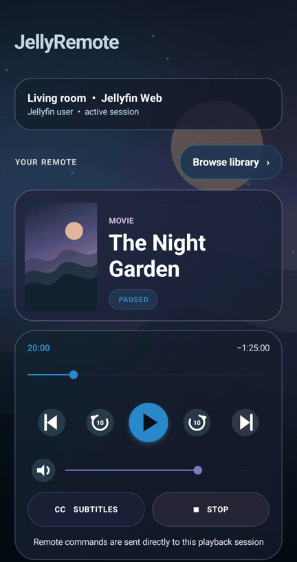
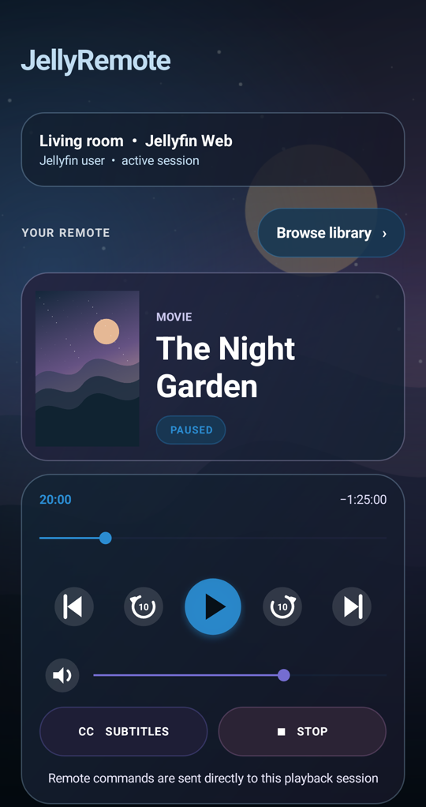
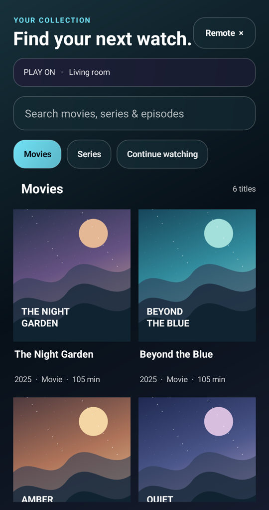
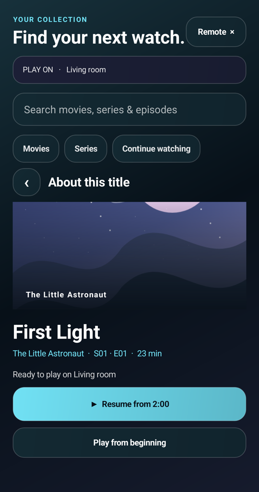

# JellyRemote

An Android remote control for Jellyfin, with library browsing and a frosted-glass interface that adapts to the artwork of the current movie or series.

**[Download the Android APK](https://github.com/TeeWare2026/JellyRemote/releases/download/v1.2.1/JellyRemote-1.2.1.apk)** · [Latest release](https://github.com/TeeWare2026/JellyRemote/releases/latest) · [Report a problem](https://github.com/TeeWare2026/JellyRemote/issues)

Android 8.0+ · Free to download · Configurable server address

<p align="center">
  
</p>

Screenshots and demo use a sample library.

<p align="center">
  
  
  
</p>

## Features

- Movie, series, season, and episode browsing, with search and Continue watching.
- Playback and resume on an existing Jellyfin session, including an idle desktop browser.
- Play/pause, stop, timeline seeking, ten-second rewind/forward, volume, mute, subtitles, and previous/next episode.
- Chapter selection and contextual intro/outro skipping when the relevant markers are available.
- Artwork-based colours, dark glass panels, and coordinated playback controls.

Video plays on the selected receiving device. Playback requires an open, signed-in Jellyfin session with remote-control support and an account with permission to control it.

This is an independent companion app, not an official Jellyfin client.

## Install and use

1. Download the APK from **Releases** and install it on Android 8.0 or newer. Android may require permission to install apps from the browser or file manager.
2. Enter the Jellyfin server address, including any configured port or base path.
3. Sign in with a Jellyfin account.
4. Open a signed-in Jellyfin client on the receiving device, such as Jellyfin Web on a desktop. The session can be idle or already playing.
5. JellyRemote automatically selects the active controllable session. Tap the device panel at the top to cycle when several sessions are available.
6. Open **Browse library** to find a movie or episode. The detail screen offers **Play**, **Resume**, or **Play from beginning** on the named receiving device.

Browsing does not change playback. Only pressing a play or resume action sends a playback request. The receiving device is checked again before sending; if it has disconnected, select an available session. Episodes queue up to 99 following available episodes for the next-episode control. The library has pagination, and displays only content the signed-in account can access.

The remote includes play/pause, stop, previous/next episode, ten-second rewind/forward, timeline seeking, chapter selection, mute, volume, and subtitle on/off. The chapter control appears only when the current movie or episode has chapter markers.

When Jellyfin provides Intro or Outro media segments, JellyRemote mirrors the playback client’s short-lived **Skip Intro** or **Skip Outro** control and seeks directly to the end of that segment. Current Jellyfin Media Segments and the legacy Intro Skipper prompt-timing endpoint are both supported; the button remains hidden when there is no active skip prompt.

Artwork is fetched from the Jellyfin server and sampled locally into a coordinated two-accent palette. Glass panels, buttons, progress tracks, status treatments, and ambient lighting adapt to the title while maintaining bright text and dark surfaces for readable contrast.

## Privacy and networking

- The password is sent only to the configured Jellyfin server and is never saved.
- The returned access token is kept in Android's app-private preferences. Use **Disconnect server** to erase it.
- Plain HTTP is enabled because local Jellyfin servers commonly use port 8096. Prefer HTTPS or a VPN when connecting outside the home network; do not expose port 8096 directly to the internet.
- The receiving Jellyfin client must advertise remote-control support, and the signed-in user must be allowed to control that session.

## Build

The project uses Android Gradle Plugin 8.7.3, compile SDK 35, and Java 17 language features.

```bash
export JAVA_HOME=/path/to/jdk-21
export ANDROID_HOME=/path/to/android-sdk
./gradlew assembleRelease
```

The personal sideload APK is written to `app/build/outputs/apk/release/app-release.apk`. It is a non-debuggable release build signed with the local Android development key; use a private release keystore before wider distribution.

## API compatibility

The implementation uses Jellyfin's stable session endpoints: `GET /Sessions`, play-state commands under `/Sessions/{id}/Playing/{command}`, and general commands under `/Sessions/{id}/Command`. Library browsing uses `/Items`, `/UserItems/Resume`, and `/Shows/{id}/Seasons` or `/Episodes`; starting playback uses `POST /Sessions/{id}/Playing` with `PlayNow`. Subtitle discovery supports both the current item endpoint and the older Jellyfin 10.x user-item route. Contextual skipping reads `GET /MediaSegments/{itemId}` on current servers and falls back to Intro Skipper's legacy per-episode segments endpoint.
